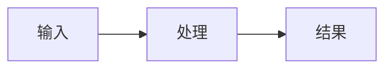

# 讲清并留档

围绕用户想理解的具体问题，交付一份脱离聊天也能读懂的图文 Markdown。讲解与图保存到同一个文件，不只在对话中展示。

## 1. 定位问题和已有说明

- 确认目标项目根目录，读取适用的 Agent 规则及根目录 `DECISIONS.md`（如有）。多仓工作区按问题实际所属项目定位，不把当前 shell 目录直接当作目标项目。
- 先用当前对话和用户给出的材料确定问题、范围和读者需要的深度；缺少会影响说明正确性的内容时再询问。
- 查 `EXPLAIN/README.md` 和相关现有文档。同一主题更新原文，不按日期另建版本，不扫描无关项目。
- 默认路径为 `<项目根目录>/EXPLAIN/<具体问题>.md`，只有一层目录。例如 `一次测评如何完成.md`、`本地电脑如何接入.md`。文件名不用日期、临时编号或“知识整理”这类泛称。
- 若已有其他位置的权威说明，优先更新原文，并在 `EXPLAIN/README.md` 链接它；不擅自搬迁或另写一套冲突的正文。用户指定路径优先。
- 通用知识没有明确项目归属时，先问保存根目录，不擅自写进当前项目或私人记忆。

## 2. 核实后解释

- 项目现状从当前源码、配置、文档和可得运行证据核实。历史对话用于找线索，不直接证明当前行为。
- 标明哪些是已核实事实、概念示例、推断、建议或待确认。只画得到依据的关系，未知连接明确标注。
- 阅读已有决策以理解约束；知识说明链接相关决策编号，不将 AI 建议或当前代码现状写成不可修改的决策，也不改写 `DECISIONS.md`。
- 只收集回答本问题所需的证据。解释请求不授权改业务代码、调用付费模型、改变运行环境或执行外部写操作。

## 3. 用最少图文讲清楚

先给直接回答，再画结构或流程，随后解释读图需要的概念、关键条件和例外。根据问题选内容，不把每篇说明扩成全系统手册。

- 默认用 Markdown 内的 Mermaid：步骤用流程图，交互顺序用时序图，生命周期用状态图，组件关系用结构图。
- 一张图回答一个主要问题。复杂时拆成总览与必要的局部图，用一致名称标识参与者、输入输出、关键分支和失败去向。
- 图旁保留简短文字解释，使不能渲染 Mermaid 的读者和 AI 仍能理解逻辑。图与正文必须表达同一行为。
- 只在空间布局、真实界面或交互确实不可替代时附加图片或 HTML；Markdown 仍包含主要解释，不能只放一个外部预览链接。附属文件使用可随文档移动的相对引用。
- 示例用具体但不敏感的输入和结果，明确标注为示例。保存前去除密钥、令牌、个人信息和无关日志。
- 使用明确名词，避免“上面那个”“刚才改的”等依赖聊天上下文的表达。解释必要术语，保留准确的代码符号帮助后续定位。

可按问题裁剪以下结构，不创建空章节：

````markdown
# 一次测评如何完成

> 适用范围：所解释的系统或版本。核实日期：YYYY-MM-DD。

直接回答用户的问题。

## 流程



解释各步骤的职责、关键条件、输出和必要例外。

## 依据与待确认

- 来源：仓库相对文件链接与符号名，或可访问的原始文档链接。
- 待确认：尚无证据的部分及其对结论的影响（如有）。
````

项目说明引用相对源码路径和关键符号；必要时补行号、版本或提交号，只记录实际核实到的值。外部知识链接原始来源，注明核实范围；不把创建日期冒充事实核实日期。

## 4. 保存、检查与交付

- 写入主题文件；首次保存时创建 `EXPLAIN/README.md`。索引每条只保留主题链接和一句话说明，后续更新已有条目，避免复制正文。
- 更新已有说明时保留仍有效内容和用户手写部分；修改受新证据影响的结论及图，移除被替代的错误解释。证据有冲突而无法判断时并列注明，不默默选一边。
- 检查图中的节点、分支与正文是否一致，来源和相对链接是否存在，是否残留对话指代或未标注猜测。使用现有 Mermaid 预览能力时核实渲染；无渲染工具则检查语法并明确未做渲染验证，不为纯文档安装一套应用或启动开发服务。
- 最终回复给出文档链接和简短结论，指出重要待确认项。不要将完整文档再复制进对话。
- 本技能只保证本次讲解落盘；若用户要求所有后续任务自动读取这些文档，需另行接入项目 Agent 规则，不能声称安装技能就已实现。

创建本技能本身不授权创建项目知识文档、修改项目规则或恢复已暂停的开发任务。
